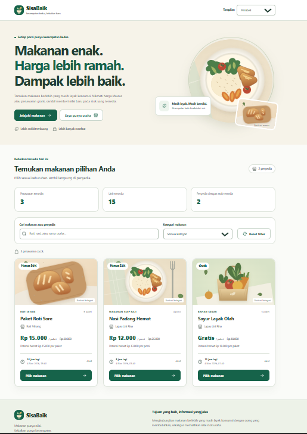
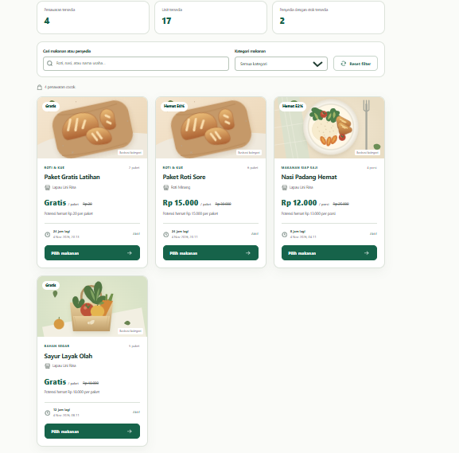
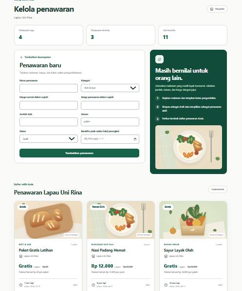
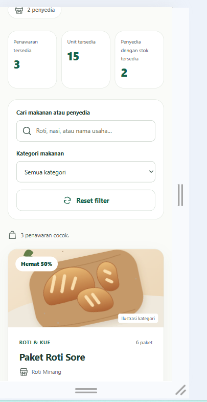
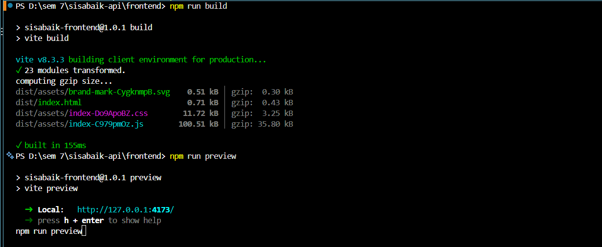
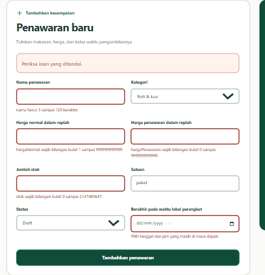

# Dokumentasi Hasil Pengujian Chapter 9
## Proyek SisaBaik

### 1. Informasi Pengujian

- Nama proyek: SisaBaik
- Modul: Chapter 9 — Membangun Antarmuka dengan Vue
- Framework: Vue 3
- Build tool: Vite
- Node.js: v24.21.0
- npm: 11.19.0
- Penguji: [Isi nama kamu]
- Branch: feature/vue-components

### 2. Hasil Pengujian Fungsional

**2.1 Pengujian pencarian LAPAU**

Hasil aktual: Sistem menampilkan dua kartu penawaran dari Lapau Uni Rina.

Status: Berhasil.

**2.2 Pengujian filter kategori**

Hasil aktual: Setelah memilih kategori roti, sistem menampilkan satu kartu Paket Roti Sore.

Status: Berhasil.

**2.3 Pengujian pemilihan makanan**

Hasil aktual: Ringkasan pilihan diperbarui dan stok tetap tidak berubah.

Status: Berhasil.

**2.4 Pengujian mode penyedia**

Hasil aktual: Mode Penyedia Rina menampilkan tiga penawaran, dua penawaran tersedia, dan sembilan unit.

Status: Berhasil.

**2.5 Pengujian validasi formulir**

Hasil aktual:
- Formulir kosong menampilkan pesan validasi.
- Harga penawaran yang melebihi harga normal ditolak.
- Harga penawaran nol diterima sebagai harga gratis.

Status: Berhasil.

**2.6 Pengujian penambahan penawaran**

Hasil aktual: Paket Gratis Latihan berhasil ditambahkan dengan stok dua paket. Ringkasan berubah menjadi empat penawaran, tiga penawaran tersedia, dan sebelas unit.

Status: Berhasil.

**2.7 Pengujian pergantian mode**

Hasil aktual: Ketika kembali ke mode Pembeli, sistem menampilkan empat kartu, tujuh belas unit, dan dua penyedia.

Status: Berhasil.

**2.8 Pengujian refresh browser**

Hasil aktual: Setelah halaman di-refresh, data kembali ke tiga kartu, lima belas unit, dan dua penyedia.

Status: Berhasil.

### 3. Pengujian Responsivitas dan Keyboard

Pengujian dilakukan menggunakan Chrome DevTools pada ukuran:

- 375 px: tampilan HP.
- 768 px: tampilan tablet.
- 1280 px: tampilan desktop.

Hasil aktual: Tata letak menyesuaikan ukuran layar dan tidak terlihat berantakan.

Pengujian keyboard dilakukan menggunakan Tab, Shift+Tab, dan tautan Lewati ke konten. Tautan berhasil mengarahkan pengguna ke bagian utama katalog.

Status: Berhasil berdasarkan pemeriksaan visual dan navigasi dasar.

### 4. Pengujian Batas Waktu Penawaran

Pengujian dilakukan dengan mengubah waktu kedaluwarsa Nasi Padang Hemat menjadi 15 detik melalui fixture sementara.

Hasil aktual:
- Kartu Nasi Padang Hemat hilang setelah waktu berakhir.
- Penawaran tersedia menjadi dua.
- Unit tersedia menjadi sebelas.
- Timer memperbarui tampilan secara berkala.

Setelah pengujian, nilai fixture dikembalikan menjadi delapan jam.

Status: Berhasil.

### 5. Hasil Build dan Preview

Perintah build:

`npm run build`

Hasil aktual:
- 23 modul berhasil dikompilasi.
- File index.html berhasil dihasilkan.
- File CSS, JavaScript, dan SVG berhasil diproses.
- Build selesai tanpa error.

Perintah preview:

`npm run preview`

Alamat preview: http://127.0.0.1:4173/

Hasil aktual: Aplikasi berhasil ditampilkan dan fitur utama dapat diperiksa melalui browser.

Status: Berhasil.

### 6. Catatan Implementasi

- Data latihan menggunakan fixture yang disimpan sementara di memori browser.
- Data tambahan tidak bertahan setelah halaman di-refresh.
- Frontend Chapter 9 belum terhubung ke API backend.
- Pemilihan makanan belum menghasilkan transaksi, pembayaran, atau pengurangan stok.
- Data yang digunakan merupakan data latihan, bukan transaksi nyata.

### 7. Kesimpulan

Pembangunan antarmuka SisaBaik menggunakan Vue 3 dan Vite telah berhasil dilakukan. Komponen, pengelolaan state, props, emits, computed, validasi formulir, filter, serta perubahan tampilan telah diuji melalui skenario praktikum.

Proses build produksi dan preview juga berhasil dijalankan tanpa error.

### 8. Bukti Pengujian

Lampirkan screenshot berikut:
- Tampilan katalog pembeli.
- Tampilan daftar penawaran penyedia.
- Formulir dengan validasi.
- Penambahan penawaran berhasil.
- Tampilan responsif HP, tablet, dan desktop.
- Hasil pengujian batas waktu.
- Terminal saat npm run build berhasil.

## 8. Bukti Pengujian
- Tampilan Beranda

- Proses Pembelian Berhasil

- Proses Penyedia Berhasil

- Tampilan Responsif

- Hasil Build dan Preview

- 8.6 Validasi Form
